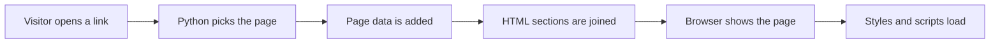
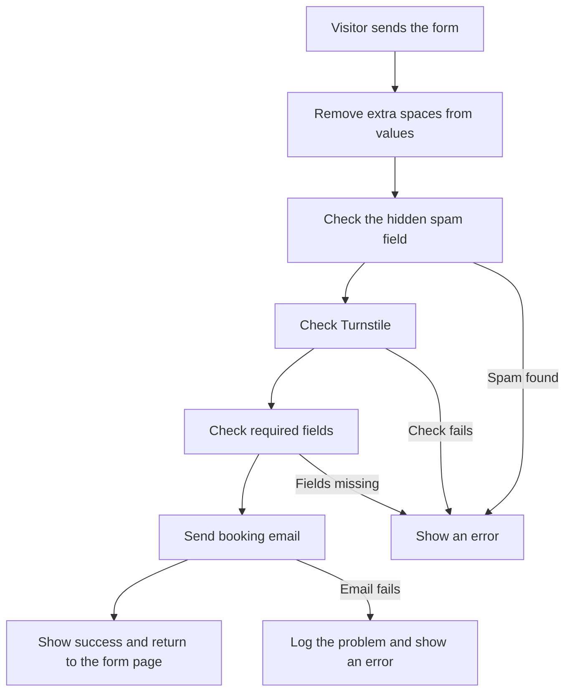

# How the Visa Culture website works

Use this guide to understand the project and find the right place to make a change. Use the [file list](FILE_INDEX.md) when you need to look up one file.

## The simple picture

Python receives a page request and picks the right HTML file. That file adds the page sections. The browser shows the finished page and loads its styles, images and JavaScript.

- **Flask** is the Python tool that runs the website.
- **Jinja** fills HTML files with data and joins page sections together.
- **CSS** controls how pages look.
- **JavaScript** controls things such as menus, sliders and buttons.

There is no database in the current app. Booking requests are sent by email.



## Read these files first

1. [`app.py`](../app.py) starts the app.
2. [`backend/__init__.py`](../backend/__init__.py) loads settings and sets up Flask.
3. [`backend/routes/__init__.py`](../backend/routes/__init__.py) connects the groups of page links.
4. [`templates/base.html`](../templates/base.html) holds the shared page frame.
5. [`templates/index.html`](../templates/index.html) shows how a page is made from smaller sections.
6. [`backend/routes/booking.py`](../backend/routes/booking.py) shows how a submitted form is handled.

## Main folders

```text
Visa Culture/
├── app.py               Starts the website
├── backend/             Python code
│   ├── config.py        Settings and default values
│   ├── routes/          Code for each page link
│   ├── data/            Lists shown on pages
│   └── services/        Email and spam checks
├── templates/           HTML and page text
│   ├── components/      Small parts shared by pages
│   ├── partials/        Page sections
│   ├── styles/          Styles that need Python page values
│   └── scripts/         Scripts that need Python page links
├── static/
│   ├── css/             Styles loaded by the browser
│   ├── js/              Scripts loaded by the browser
│   └── images/          Images
├── tests/               Checks for the website
├── tools/               Tools for working on the code
└── docs/                Team guides
```

A **route** is the Python code linked to a URL, such as `/booking`. A **template** is an HTML file used to make a page. A **partial** is a smaller HTML section included in a page.

## Python files

| File | What it does |
| --- | --- |
| `app.py` | Starts the app and makes it available to the web server |
| `backend/__init__.py` | Loads `.env`, sets up Flask, and connects routes |
| `backend/config.py` | Reads settings such as email details and spam-check keys |
| `backend/routes/__init__.py` | Connects all route groups |
| `backend/routes/pages.py` | Opens the homepage and IELTS/PTE pages |
| `backend/routes/destinations.py` | Opens country guides and adds their page data |
| `backend/routes/universities.py` | Opens the six university pages |
| `backend/routes/booking.py` | Checks and handles booking form submissions |
| `backend/routes/redirects.py` | Sends visitors from old links to current links |
| `backend/routes/seo.py` | Returns the sitemap and rules for search engines |
| `backend/data/destinations.py` | Holds university/country lists for destination guides |
| `backend/data/australia.py` | Holds Australia university cards, numbers and steps |
| `backend/data/sitemap.py` | Lists the pages included in the sitemap |
| `backend/services/booking_email.py` | Writes and sends booking emails |
| `backend/services/turnstile.py` | Checks Cloudflare Turnstile responses to reduce spam |

The app setup runs when the website starts. It does not run again for every page request.

Most fixed page text is in HTML sections. Lists used by Python page handlers are in `backend/data/`. There is no separate content editing system.

## Which page uses which files

| Page link | Main HTML file | Page sections |
| --- | --- | --- |
| `/` | `templates/index.html` | `templates/partials/home/` |
| `/booking` | `templates/booking.html` | `templates/partials/booking/` |
| `/australia` | `templates/australia.html` | `templates/partials/destinations/australia/` |
| `/usa` | `templates/usa.html` | `templates/partials/destinations/usa/` |
| `/uk` | `templates/uk.html` | `templates/partials/destinations/uk/` |
| `/canada` | `templates/canada.html` | `templates/partials/destinations/canada/` |
| `/europe` | `templates/europe.html` | `templates/partials/destinations/europe/` |
| `/more` | `templates/more.html` | `templates/partials/destinations/more/` |
| `/ielts-preparation` | `templates/ielts_preparation.html` | `templates/partials/preparation/ielts/` |
| `/pte-preparation` | `templates/pte_preparation.html` | `templates/partials/preparation/pte/` |
| `/australia/university-of-melbourne` | `templates/melbourne_landing.html` | `templates/partials/universities/melbourne/` |
| `/australia/australian-national-university` | `templates/anu_landing.html` | `templates/partials/universities/anu/` |
| `/australia/university-of-sydney` | `templates/sydney_landing.html` | `templates/partials/universities/sydney/` |
| `/australia/unsw-sydney` | `templates/unsw_landing.html` | `templates/partials/universities/unsw/` |
| `/australia/monash-university` | `templates/monash_landing.html` | `templates/partials/universities/monash/` |
| `/australia/university-of-queensland` | `templates/uq_landing.html` | `templates/partials/universities/uq/` |

`/booking` accepts both opening the page and sending the form. `/robots.txt` returns search-engine rules. `/sitemap.xml` lists page URLs. Files under `static/` are available through `/static/`.

Old university links under `/universities/` and the old IELTS/PTE links ending in `-sheikhupura` are handled in `backend/routes/redirects.py`. Keep those redirects working when changing links.

## How HTML files fit together

`templates/base.html` holds the shared page frame: search information, navigation, footer, shared styles, scripts and floating contact buttons.

A main page file, such as `uk.html`, supplies its title, short description and list of sections. Its smaller sections hold the visible text and HTML.

```text
uk.html
  ├── uses base.html for the shared frame
  └── adds sections from partials/destinations/uk/
        ├── overview.html
        ├── work-and-lifestyle.html
        ├── settling.html
        ├── institutions.html
        └── consultation.html
```

These Jinja words appear in templates:

| Word | Simple meaning |
| --- | --- |
| `extends` | Use another file as the page frame |
| `block` | A place where a page adds its own content |
| `include` | Add the contents of another file here |
| `macro` | A small reusable piece of HTML that accepts values |
| `url_for` | Build a link from its Python route name |

An included section does not have its own public URL. Keep route names used by `url_for` unchanged when moving Python code.

## Page section names

| Name | What it usually contains |
| --- | --- |
| `overview.html` | Hero image, introduction and education overview |
| `work-and-lifestyle.html` | Work sectors and student life |
| `settling.html` | Planning, checklists and settling in |
| `institutions.html` | University or country lists |
| `introduction.html` | Opening content and reasons to choose a university |
| `study-and-admissions.html` | Courses, entry requirements, costs and scholarships |
| `student-life-and-process.html` | Student life and application steps |
| `faq-and-consultation.html` | Questions, answers and consultation links |
| `consultation.html` | Closing booking message and link |

The homepage has its own sections under `partials/home/`. Office contact details are in the shared footer.

The booking page uses `introduction.html`, `form.html` and `next-steps.html` under `partials/booking/`.

IELTS and PTE each have four section files. They share the panel and enquiry-button code in `templates/components/preparation.html`.

The shared navigation, footer and contact-button HTML is in `templates/partials/layout/`.

`templates/partials/schema/` holds university FAQ data for search engines. Keep it in agreement with the answers people can read on the page.


## How booking works



Required fields are name, phone, address and service type. The hidden `website` field helps catch bots. If Turnstile keys are missing, the current code skips that check and logs a warning. If the keys are set but verification fails, it rejects the request.

The email code can also send a confirmation when the visitor gives a usable email address. On email failure, the page receives the original form values. On success, it redirects back to `/booking` and shows a success message. No booking is stored in a database.

Keep field names and check order unchanged unless the task asks for a behavior change.

## Where styles live

| Location | What to change there |
| --- | --- |
| `static/css/home/` | Homepage colors, spacing and sections |
| `static/css/booking/` | Booking layout and form styles |
| `static/css/layout/` | Shared layout, footer and floating buttons |
| `static/css/responsive/` | Phone/tablet sizes, menus and layout fixes |
| `static/css/animations/` | Movement, hover effects and animation settings |
| `static/css/landing-common.css` | Styles shared by university pages |
| `static/css/university-editorial.css` | Shared university layout and image rules |
| `static/css/layout-overrides.css` | Shared rules loaded later to adjust earlier styles |
| `templates/styles/destinations/` | Destination styles that use page values |
| `templates/styles/universities/` | University styles that use page values |

Some CSS files are only lists of `@import` lines. They load smaller style files in order. Examples are `pages/home.css`, `pages/booking.css`, `base-inline.css`, `responsive.css` and `premium-animations.css`.

CSS under `templates/styles/` ends in `.css.jinja`. It needs Jinja to fill in values such as image links or colors. Keep it there; a normal static CSS file will not fill in those values.

The shared head loads responsive styles, then page styles, then base styles and shared adjustments. Later rules can change earlier ones. Keep the order in CSS imports and template includes. Search for a selector in all style folders before removing a repeated rule.

## Where browser actions live

| File or folder | What it controls |
| --- | --- |
| `static/js/home/hero-carousel.js` | Homepage slides, arrows, dots and touch controls |
| `static/js/home/budget-guidance.js` | Places the destination section after budget guidance |
| `static/js/home/services.js` | Service tabs, cards and automatic changes |
| `static/js/home/mobile-content.js` | Show-more buttons and short text on phones |
| `static/js/layout/` | Shared text effects, icons, reveal effects and contact menus |
| `static/js/booking.js` | Date picker and preferred test/destination labels |
| `static/js/university-interactions.js` | University reveal effects, counters and page scrolling |
| `static/js/premium-animations.js` | Shared university animation helpers |
| `static/js/premium-pages.js` | Page changes, card hover effects and browser Back behavior |
| `static/js/tailwind-config.js` | Tailwind theme settings |
| `templates/scripts/mobile-navigation.js.jinja` | Phone menu behavior and page matching |

The scripts run in the order shown by the templates. Keep that order. Adding `async`, `defer` or `type="module"` can change when they run.


## Settings and outside services

`.env.example` lists setting names. `.env` holds your local values. Hosting settings can supply the same values online. Existing environment values take priority over `.env`.

| Setting | What it is for |
| --- | --- |
| `SECRET_KEY` | Signs the session used for messages after form submissions |
| `SMTP_HOST`, `SMTP_PORT`, `SMTP_USER`, `SMTP_PASSWORD` | Connect to the email provider |
| `BOOKING_RECIPIENTS` | Email addresses that receive bookings |
| `TURNSTILE_SITEKEY`, `TURNSTILE_SECRET_KEY` | Set up the spam check |

Do not put real passwords in code or guides. Shared Python services read app settings through Flask's `current_app`. They should not import `app.py`.

The browser also uses Tailwind, Google Fonts, Feather icons and a Google Maps embed. Email uses the SMTP provider. Turnstile uses Cloudflare. If one of these services is unavailable, check it separately from local code.

## Where to make common changes

| I want to change... | Start here |
| --- | --- |
| Page title or search description | That page's main template |
| Page text | That page's file under `templates/partials/` |
| Office address or phone | Layout footer and business data in `base.html` |
| Australia university cards | `backend/data/australia.py` |
| Other destination lists | `backend/data/destinations.py` |
| Form fields | `templates/partials/booking/form.html` |
| Form checks or messages | `backend/routes/booking.py` |
| Booking email text | `backend/services/booking_email.py` |
| Phone menu | Layout HTML, the phone navigation script and responsive menu CSS |
| Sitemap links | `backend/data/sitemap.py` |
| Old link redirects | `backend/routes/redirects.py` |

## Adding a page

1. Add its Python handler and URL to the right file in `backend/routes/`.
2. Add its main HTML file using `base.html`.
3. Give it its own title and search description.
4. Put larger page sections in the right `partials/` folder.
5. Add any needed styles and scripts in the matching feature folders.
6. Link to it from an existing page.
7. If it should appear in search, add it to `backend/data/sitemap.py`.
8. Run the checks and open it at desktop and phone sizes.

## Checks and expected results

Run the commands in the [README](../README.md) before handing over a change.

| File | What it does |
| --- | --- |
| `tests/test_regression.py` | Checks pages, routes, forms, email, spam checks and files |
| `tests/test_seo.py` | Checks search titles, descriptions, main page links, search data and local contact details |
| `tests/contracts.py` | Helps compare page output and CSS rules |
| `tests/browser_check.py` | Compares desktop/phone pages with an older Git version |
| `tests/reference_app.py` | Reads that older version from Git |
| `tests/fixtures/` | Stores expected results used by the checks |
| `tools/format_styles.py` | Tidies spacing in CSS files |

A **fixture** is a saved example or expected result. The files in `tests/fixtures/` cover page output, CSS rules, scripts, example templates and the older Git version used for browser checks.

A failed check may mean a bug, or it may show a change you intended to make. Read the difference first. Update only the saved results affected by an approved behavior or content change.

The older browser version was saved before the new local SEO content. Homepage differences are therefore expected. Review these differences rather than changing the saved version just to make the check pass. That older Git version must be available on your machine.

## Putting the website online

`Dockerfile` installs the needed Python packages and starts Gunicorn on port 8080. It uses `app:app`, two workers and four threads. It runs as `appuser`. Keep the current start command unless deployment is part of the task.

`requirements.txt` lists the packages needed to run the website. `requirements-dev.txt` adds packages used for checks and formatting. No separate frontend build is needed.

## If something goes wrong

| Problem | Look here first |
| --- | --- |
| Wrong page or missing section | Route, main template name and include path |
| Style change is not visible | CSS import, later rules and phone/tablet rules |
| `{{ ... }}` appears in CSS or JavaScript | A Jinja file may have been served as a normal static file |
| Button or menu stops working | Script position, HTML IDs and browser console |
| Booking fails | Form checks, Turnstile keys, email settings and app logs |
| Search check fails | Page title/description, `base.html`, sitemap and SEO tests |
| Map, font or icon is missing | Outside service as well as local files |

## Keep the guides useful

When you add, move or remove a file, update this guide and the [file list](FILE_INDEX.md). Keep the README short. Put search-related upkeep in the [SEO guide](../SEO_MAINTENANCE.md).
